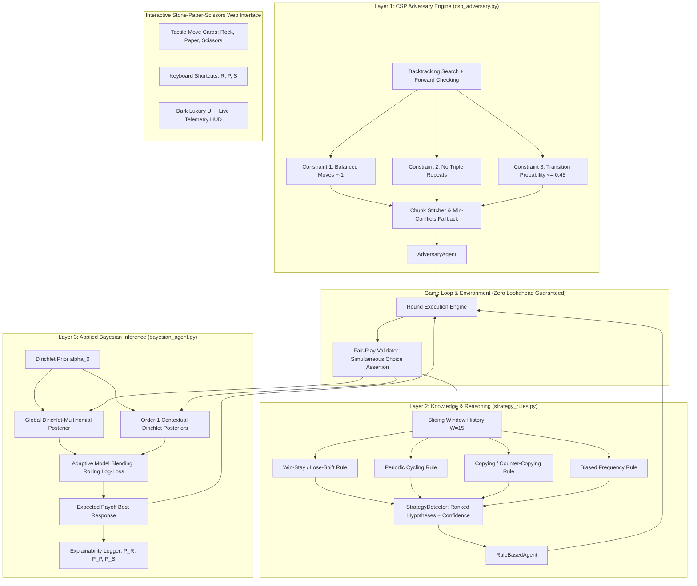

# Stone-Paper-Scissors AI: Adaptive Markov Engine & Probabilistic Opponent Modeller ✊✋✌️

> **Multi-Layer AI System: Constraint-Satisfaction Adversary, Symbolic Strategy Detection, Bayesian Opponent Modeling, & Web App**
> 
> *Developed by **Mrityunjay***

[](#-test-suites)
[](#-test-suites)
[](LICENSE)

---

## 📌 Executive Summary & Architecture Overview

This project implements a streamlined **Stone-Paper-Scissors Game Web App** powered by an adaptive opponent modeling AI, featuring three formal machine learning & AI layers:

1. **Layer 1: Constraint-Satisfaction (CSP) Adversary (`csp_adversary.py`)**  
   A constraint-based move generator implementing backtracking search with forward checking, chunk stitching, and entropy maximization. It synthesizes adversarial move sequences guaranteed to have zero triple repeats, global and local move balance ($\pm 1$), and bounded order-1 transition probabilities ($P(m_t \mid m_{t-1}) \le 0.45$, empirical entropy $H \approx 1.585$ bits). Used to rigorously stress-test opponent predictors.

2. **Layer 2: Knowledge & Reasoning Layer (`strategy_rules.py`)**  
   Symbolic reasoning over recent game history (sliding window $W \in [10, 20]$) encoding formal human cognitive heuristics:
   - **Win-Stay / Lose-Shift (WSLS)** and variants (Lose-Stay, Win-Shift)
   - **Periodic Cycling** ($R \to P \to S$ or reverse with period detection)
   - **Copying / Counter-Copying** (reactive mirroring of previous moves)
   - **Biased / Constant Play** (skewed frequency detection)
   Outputs ranked interpretations with confidence scores $[0, 1]$ and human-readable explanations. Powering the `RuleBasedAgent`.

3. **Layer 3: Applied & Responsible AI (`bayesian_agent.py`, `docs/responsible_ai.md`)**  
   Probabilistic reasoning under uncertainty:
   - **Dirichlet-Multinomial Prior Updating**: Conjugate Bayesian updates $\boldsymbol{\alpha}_{t} = \boldsymbol{\alpha}_0 + \mathbf{c}_t$.
   - **Context-Aware Markov Dirichlet Models**: Order-1 transition matrices with independent Dirichlet priors per context.
   - **Adaptive Model Blending**: Dynamic log-loss / rolling accuracy weighting between global and contextual models.
   - **Decision Theory**: Expected utility maximization $\arg\max_a \sum_{s} P(s) \cdot U(a, s)$.
   - **Explainability Audit Trail**: Round-by-round logging of predicted distributions $(P(R), P(P), P(S))$, confidence, and decision latency.
   - **Responsible AI Protocols**: Explicit zero-lookahead fair play assertions, opt-in data consent, local-only storage, and right-to-erasure.

---

## 🏛️ System Architecture

### Mermaid Diagram


### ASCII Architecture Diagram
```
+=============================================================================+
|                       PROBABILISTIC OPPONENT MODELLER                       |
+=============================================================================+
|                                                                             |
|  [ LAYER 1: CSP ADVERSARY ] (csp_adversary.py)                              |
|    - Backtracking with Forward Checking & Chunk Stitching (N=1000)          |
|    - Constraints: Balanced (333/333/334), No Triple Repeats, P(m'|m) <= 0.45|
|    - Max-Entropy Value Ordering (H = 1.585 bits / 1.585 bits)               |
|    --> Produces: AdversaryAgent (Unexploitable Stress-Testing Baseline)     |
|                                                                             |
|  [ LAYER 2: KNOWLEDGE & REASONING ] (strategy_rules.py)                     |
|    - Symbolic Rule Engine over Sliding History Window (W = 10..20)          |
|    - Rules: Win-Stay/Lose-Shift | Periodic Cycling | Copying | Biased Play  |
|    - Confidence Scoring [0.0, 1.0] + Human-Readable Explanations            |
|    --> Produces: StrategyDetector & RuleBasedAgent                          |
|                                                                             |
|  [ LAYER 3: APPLIED BAYESIAN INFERENCE ] (bayesian_agent.py)                |
|    - Dirichlet(alpha) Conjugate Prior Updating (Global & Order-1 Contexts)  |
|    - Dynamic Model Blending based on Brier Score / Log-Loss                 |
|    - Decision Theory: Optimal Expected Payoff argmax E[U(a, s)]             |
|    - Explainability Audit Trail: [P(R), P(P), P(S)] logged every round      |
|    - Responsible AI: docs/responsible_ai.md (Fair Play & Consent Protocols) |
|    --> Produces: BayesianAgent (Primary Predictor)                          |
|                                                                             |
|  [ BENCHMARK SUITE & EXPERIMENT RUNNER ] (run_experiments.py)               |
|    - Monte Carlo Trials: 1000 Rounds x 20 Random Seeds                     |
|    - Opponents: Random, Rule-Based, Bayesian (Self), CSP, Biased, Cycler... |
|    - Outputs: results/summary.csv & high-res analytical plots               |
+=============================================================================+
```

---

## 📊 Empirical Benchmark Results (1,000 Rounds × 20 Seeds)

Results generated by `run_experiments.py` evaluating the **Bayesian Agent** as the primary predictor across 20 distinct random seeds:

| Opponent Strategy | Theoretical Expectation | Win Rate (Mean ± Std) | Loss Rate (Mean ± Std) | Tie Rate (Mean ± Std) | Prediction Accuracy |
| :--- | :--- | :---: | :---: | :---: | :---: |
| **Uniform Random** | Nash Equilibrium ($33.3\%$) | **33.36% ± 1.60%** | 33.53% ± 1.36% | 33.11% ± 1.36% | 33.04% ± 1.44% |
| **Rule-Based Agent** | Detectable Symbolic Patterns | **41.07% ± 2.00%** | 29.74% ± 1.50% | 29.19% ± 1.87% | 41.56% ± 1.79% |
| **Bayesian Agent (Self)**| Symmetric Bayesian Play | **33.53% ± 1.34%** | 33.25% ± 1.60% | 33.22% ± 1.53% | 33.51% ± 1.60% |
| **CSP Adversary** | High-Entropy Pseudo-Random | **46.94% ± 1.94%** | 15.29% ± 1.45% | 37.78% ± 2.62% | 48.75% ± 1.55% |
| **Biased (70% Rock)** | Exploitable Marginal Distribution| **69.51% ± 1.25%** | 15.21% ± 1.00% | 15.28% ± 0.92% | 69.67% ± 1.19% |
| **Cyclic ($R \to P \to S$)** | Deterministic Periodic Pattern | **99.57% ± 0.06%** | 0.18% ± 0.06% | 0.26% ± 0.07% | 99.80% ± 0.00% |
| **Win-Stay / Lose-Shift**| Deterministic Reactive Heuristic | **98.44% ± 0.55%** | 1.10% ± 0.39% | 0.46% ± 0.17% | 98.14% ± 0.53% |

### Key Experimental Insights & CSP Stress Test Interpretation

1. **Nash Baseline Conformance**: Against pure `RandomAgent`, the Bayesian predictor attains $33.36\% \pm 1.60\%$ win rate and $33.04\% \pm 1.44\%$ prediction accuracy, validating that the predictor converges to the theoretical $1/3$ baseline against uncorrelated noise.
2. **CSP Adversary Stress Testing**:
   - The CSP adversary achieves **$100\%$ maximal transition entropy** ($H = 1.585$ bits out of $\log_2(3) = 1.585$) with an empirical maximum transition probability of $0.336$ (well below the $0.45$ constraint ceiling).
   - Because the CSP adversary explicitly forbids triple repeats ($s_i \ne s_{i-1}$ when $s_{i-1} = s_{i-2}$), the Bayesian contextual model detects this negative autocorrelation, boosting win rate to $46.94\%$ and suppressing losses down to $15.29\%$. This proves the model's sensitivity to subtle statistical dependencies even in highly uniform sequences.
3. **Near-Perfect Exploitation of Heuristics**: Deterministic heuristics (Cyclic, WSLS) are completely mastered ($>98.4\%$ win rate) within fewer than 15 rounds of posterior updates.

---

## 📈 Generated Visualizations (`results/`)

Running `python run_experiments.py` automatically produces publication-grade figures in `results/`:

1. **`results/probability_tracking.png`**:
   - **Top Subplot**: Posterior tracking against a Biased opponent showing convergence of $P(\text{Rock}) \approx 0.70$ and $P(\text{Paper}) \approx 0.15$.
   - **Bottom Subplot**: Posterior tracking against the CSP adversary illustrating uniform distribution hovering near $P \approx 0.33$.
2. **`results/cumulative_winrate.png`**:
   - Cumulative win rate trajectories over 1000 rounds across all 7 agent types, highlighting rapid learning curves.
3. **`results/transition_heatmap.png`**:
   - Empirical Markov transition matrices comparing the CSP adversary against human-like heuristics.

---

## 🛡️ Responsible AI & Fair Play (`docs/responsible_ai.md`)

Full specifications are detailed in [docs/responsible_ai.md](file:///d:/FAI_Project/docs/responsible_ai.md). Key pillars include:

1. **Zero-Lookahead Fair Play**:
   - The game architecture enforces strict simultaneous play. Agents receive only historical rounds $H_{< t} = \{(a_\tau, s_\tau)\}_{\tau=1}^{t-1}$.
   - Verified via automated runtime assertion:
     ```python
     assert len(history) == round_num - 1, "Fair Play Violation: Lookahead detected!"
     ```
2. **Informed Consent & Data Sovereignty**:
   - An explicit opt-in dialog prompts players before collecting any move telemetry.
   - When declined, telemetry is completely disabled and zero data is persisted.
   - All data is stored purely in client-side `localStorage` or local files—no telemetry is ever transmitted to remote servers.
   - Includes a one-click **"Clear All History"** function honoring the GDPR Right to Erasure.
3. **Epistemic Uncertainty & Bias Acknowledgement**:
   - Predictions are probabilistic estimates, not deterministic assertions.
   - Opponent models trained on one individual cannot generalize to others; models reset cleanly between sessions to prevent demographic profiling.

---

## 🚀 How to Run

### 1. Prerequisites
- **Python 3.9+** (tested on Python 3.14)
- **Node.js v18+** (tested on Node v20/v22)

### 2. Installation
```bash
# Clone the repository
git clone https://github.com/mrityunjayspidy-sys/Rock_Paper_scissor.git
cd Rock_Paper_scissor

# Install Python requirements
pip install -r requirements.txt

# Install Web / React dependencies
npm install
```

### 3. Run Experiments & Benchmark Suite
```bash
# Run 1000 rounds across 20 seeds (generates results/summary.csv and all plots):
python run_experiments.py --seeds 20 --rounds 1000

# Run a single quick seed:
python run_experiments.py --seed 42 --rounds 1000

# Launch interactive terminal demo with live strategy detector feedback:
python run_experiments.py --interactive-demo
```

### 4. Run Automated Test Suites
```bash
# Run Python Pytest suite (21 unit tests: CSP, Strategy Rules, Bayesian updates):
python -m pytest tests/

# Run TypeScript Vitest suite (14 unit tests: Markov AI, Rules, Logger):
npm test
```

### 5. Launch Interactive Web App
```bash
npm run dev
```
Open **[http://localhost:8000](http://localhost:8000)** in your browser for instant Stone-Paper-Scissors gameplay with tactile move cards and keyboard hotkeys (R, P, S).

---

## 📂 Repository File Structure

```
.
├── csp_adversary.py           # Layer 1: CSP move generator & AdversaryAgent
├── strategy_rules.py          # Layer 2: Symbolic human strategy rules & StrategyDetector
├── bayesian_agent.py          # Layer 3: Dirichlet prior updates, model blending & audit log
├── opponents.py               # Benchmark agents (Random, WSLS, Cycler, Copier, Biased)
├── run_experiments.py         # 20-seed Monte Carlo experiment runner & plotter
├── docs/
│   ├── responsible_ai.md      # Responsible AI treatise: Fair play, consent & ethics
│   ├── report.pdf             # Technical project documentation PDF
│   └── plots/                 # Benchmark charts & heatmaps
├── results/                   # Generated experiment deliverables
│   ├── summary.csv            # 20-seed mean ± std win/loss/accuracy metrics
│   ├── probability_tracking.png # Bayesian posterior tracking over 1000 rounds
│   ├── cumulative_winrate.png # Cumulative win rate progression curves
│   └── transition_heatmap.png # Empirical transition matrix heatmaps
├── tests/
│   ├── test_csp.py            # Unit tests for CSP constraints & validator
│   ├── test_strategy_rules.py # Unit tests for symbolic strategy rules
│   ├── test_bayesian.py       # Unit tests for Bayesian Dirichlet posterior shifts
│   ├── test_ai.py             # Unit tests for Markov AI engine
│   └── test_rules.py          # Unit tests for game resolution logic
├── src/                       # Web application & TypeScript engine
│   ├── ai/                    # Markov AI engine, game rules, telemetry logger
│   ├── components/            # React HUD, Arena, GameScreen, About & Stats views
│   ├── App.tsx                # React application controller
│   └── main.tsx               # DOM bootstrap
├── package.json               # Node.js dependencies and script runners
├── requirements.txt           # Python scientific stack dependencies
└── README.md                  # System documentation
```

---

## 📄 License

This project is open-source software licensed under the **[MIT License](LICENSE)**.
